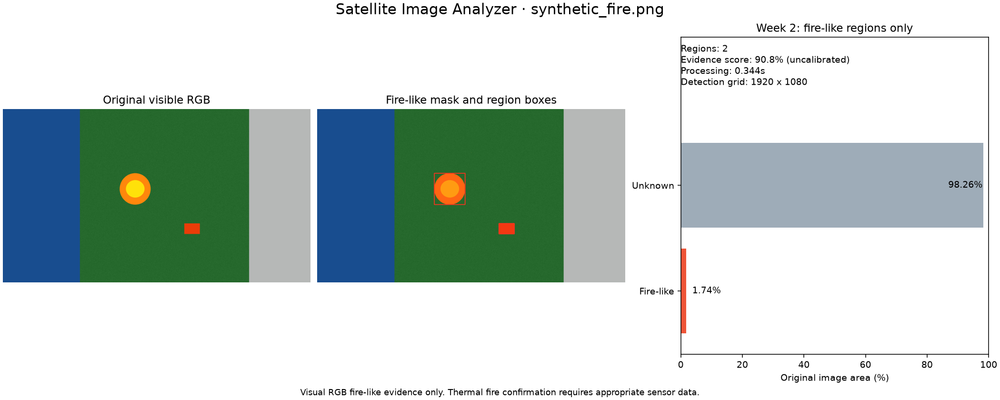
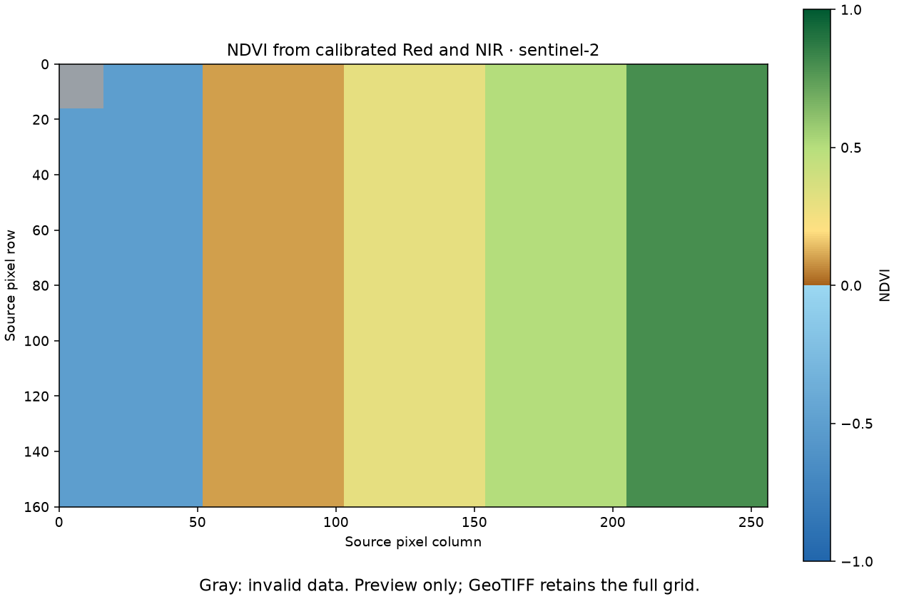

# Satellite Image Analyzer

## Overview

Satellite Image Analyzer is a modular Python application for inspecting satellite
imagery, preparing rasters, and finding visible fire-like regions with classical
computer vision. Week 2 adds an end-to-end RGB fire analysis command, image
outputs, numerical statistics, and a JSON report. Week 3 adds real Red/NIR NDVI,
georeferenced vegetation classes, valid-pixel statistics, and scientific previews.

This is a visual fire-like region detector for RGB imagery, not a thermal satellite fire detection system.

The detector uses real pixels, configurable thresholds, and connected components.
It does not call a trained model or invent AI predictions. NDVI uses separately
measured spectral channels; ordinary RGB imagery cannot supply a genuine NIR band.
Water/urban classifiers and risk scoring remain future work.

## Features

- Inspect PNG, JPG, JPEG, TIFF, and GeoTIFF metadata.
- Validate paths and reject corrupt or unsuitable image data with clear errors.
- Resize, normalize, and denoise imagery with the Week 1 preprocessing command.
- Detect bright red/orange/yellow RGB regions, filter small components, and draw boxes.
- Export an analyzed image, binary mask, overlay, summary figure, and JSON report.
- Preserve source files and previous runs through separate output directories.
- Provide typed detector boundaries for future trained implementations.
- Compute real NDVI from aligned, calibrated Red/NIR GeoTIFF bands or explicit
  multiband mappings; preserve full-resolution geospatial data in exports.
- Classify initial vegetation density ranges and export heatmap, histogram,
  georeferenced class map, and radiometric/alignment provenance.

## Architecture

The CLI delegates loading, configuration, detection, reporting, and visualization
to independent modules. Fire analysis uses its own visible RGB preparation path
so thresholds operate on 8-bit RGB/HSV rather than normalized raster values.
The NDVI path uses a separate spectral loader, radiometric validation, and native
geospatial grid. See [architecture documentation](docs/architecture.md) and the
[Week 3 NDVI guide](docs/week3_ndvi.md).

## Installation

Python 3.12 or newer is required. In PowerShell:

```powershell
cd "C:\path\to\satellite-image-analyzer"
$env:PYTHONUTF8 = '1'
py -3.12 -m venv .venv
.\.venv\Scripts\python.exe -m pip install --upgrade pip
.\.venv\Scripts\python.exe -m pip install -e ".[dev]"
```

Activation is optional; these commands avoid PowerShell script execution-policy
issues. UTF-8 mode also supports repository paths containing non-ASCII characters
when installing with Windows Python 3.12. Use `pip install -e .` with the
environment's Python for a runtime-only installation. `requirements.txt` mirrors
runtime dependencies in `pyproject.toml`.

## Usage

```powershell
.\.venv\Scripts\python.exe main.py analyze "data\samples\satellite.jpg" --output results
.\.venv\Scripts\python.exe main.py analyze "C:\images\satellite.png" --config configs\default.toml --save-overlay --verbose
.\.venv\Scripts\python.exe main.py analyze image.png --json
.\.venv\Scripts\python.exe main.py --help
.\.venv\Scripts\python.exe main.py analyze --help
.\.venv\Scripts\python.exe main.py version
.\.venv\Scripts\python.exe main.py info image.tif
.\.venv\Scripts\python.exe main.py preprocess image.tif --width 512 --height 512 --output data\outputs\processed.png
```

All visualization files are saved by default; `--save-overlay` is accepted as an
explicit request for the overlay. `--json` emits only report JSON on stdout;
diagnostics and errors use stderr.

The installed `sat-analyzer` command and `python -m satellite_analyzer` expose the
same interface. Without activating the environment, run the installed command
as `.\.venv\Scripts\sat-analyzer.exe`.

## Example

Generate a deterministic local synthetic fixture and analyze it:

```powershell
.\.venv\Scripts\python.exe scripts\generate_sample.py
.\.venv\Scripts\python.exe main.py analyze data\samples\synthetic_fire.png --output results
```

The generator defaults to 1920×1080, marks its image as synthetic, and refuses to
overwrite an existing file. Use `--output`, `--width`, and `--height` to choose a
different path or size. This fixture verifies software behavior, not detection
accuracy on genuine satellite observations.



For your own image, place a visible RGB file in `data/samples/` and run:

```powershell
.\.venv\Scripts\python.exe main.py analyze data\samples\satellite.jpg --output results
```

The console reports input identity, original resolution, fire-like and unknown
percentages, region count, heuristic confidence, and processing time. The JSON
report additionally records the analysis resolution used by the detector.
Exact numbers depend on the image and thresholds. Synthetic test images verify
software behavior, not scientific accuracy. See [data guidance](data/README.md).

## Output

Each invocation creates a new directory such as
`results/satellite-<UTC timestamp>-<unique suffix>/`, preserving earlier runs.

| File | Contents |
| --- | --- |
| `analyzed_image.png` | Visible RGB image with fire-like bounding boxes |
| `fire_mask.png` | Binary mask: 255 fire-like, 0 unknown |
| `fire_overlay.png` | Red segmentation overlay and bounding boxes |
| `analysis_summary.png` | Original image, overlay, area statistics, and confidence |
| `analysis_report.json` | Resolutions, area, confidence, regions, timing, and settings |

Reports distinguish original resolution from analysis resolution. Area counts and
percentages describe the original grid after mapping the analysis mask back to it.
Boxes use original image pixel coordinates with exclusive right/bottom extents,
not geographic coordinates. Only `fire-like` and `unknown` classes exist in Week 2:
unknown means the pixel did not pass this detector, not that it is safe.

Transparent and nodata pixels are excluded from detection, counted separately as
`invalid_pixel_count`, and included in unknown. Percentages use all original image
pixels as their denominator. Reports include the active settings for reproducibility
and state that measured analysis time excludes visualization/report export.

## Detection Methods

OpenCV HSV hue, saturation, and brightness constraints are combined with red
intensity and RGB channel relationships using vectorized NumPy operations.
Configurable mask cleanup and connected-component area filtering remove small
candidate regions. Surviving components supply masks, areas, and bounding boxes.

Confidence is a heuristic color-evidence score, not a calibrated probability of
active fire. Empty detection reports zero confidence. Matplotlib uses an
off-screen backend suitable for CLI execution on Windows.

### Configuration

`configs/default.toml` contains `[preprocessing]`, `[fire]`, and `[analysis]` sections.
Fire settings control HSV/RGB thresholds, mask cleanup, and minimum component area;
analysis settings control dimensions, pixel budget, and overlay appearance.
OpenCV 8-bit HSV uses H=0..179 and S/V=0..255. Use `--config PATH` for custom
settings; invalid values produce an error. Without an explicit config path,
validated built-in defaults allow the installed package to run outside the checkout.

The default maximum analysis dimension is 2048 pixels. Larger images are reduced
with aspect ratio preserved. `min_region_pixels` is in analysis-grid pixels, so
downsampling affects the smallest feature that can survive filtering.

## Supported Formats

| Input | `info` / `preprocess` | `analyze` |
| --- | --- | --- |
| PNG, JPG, JPEG | Pillow loading | 8-bit RGB/RGBA or grayscale |
| TIFF / GeoTIFF | Rasterio bands and metadata | 8-bit visible RGB/RGBA or grayscale |
| High-bit-depth/multispectral raster | Raster I/O where decodable | Rejected instead of guessing RGB bands |

Analysis converts grayscale to RGB and handles transparency. TIFF band
interpretation must be suitable for visible RGB; arbitrary multispectral bands
are not automatically true color. Raster metadata does not confer thermal or
geospatial detection capabilities.

## Week 3 Overview: Real NDVI

NDVI is a spectral vegetation-condition indicator:

```text
NDVI = (NIR - RED) / (NIR + RED)
```

It requires measured near-infrared and red channels. Sentinel-2 uses B04/B08 at
10 m; Landsat 8/9 use B4/B5 at 30 m. Separate single-band GeoTIFFs and explicitly
mapped multispectral GeoTIFFs are supported. CRS, transform, dimensions, NoData,
and radiometric coefficients are validated before computation. See the
[sensor and calibration details](docs/week3_ndvi.md#supported-satellite-sensors).

Generate and analyze a reproducible **synthetic** spectral fixture:

```powershell
.\.venv\Scripts\python.exe scripts\generate_ndvi_sample.py
.\.venv\Scripts\python.exe main.py ndvi --red data\samples\ndvi\B04.tif --nir data\samples\ndvi\B08.tif --sensor sentinel-2 --metadata data\samples\ndvi\MTD_MSIL2A.xml --output results\ndvi --visualize --json
```

The fixture has independent spectral arrays and known calibration; it is not a
satellite observation or an accuracy evaluation. For actual Sentinel data:

```powershell
.\.venv\Scripts\python.exe main.py ndvi --red data\sentinel2\B04.tif --nir data\sentinel2\B08.tif --sensor sentinel-2 --metadata data\sentinel2\MTD_MSIL2A.xml --visualize
```



The verified 160×256 synthetic fixture produced 40,704 valid pixels, 256 invalid
pixels, mean NDVI approximately 0.241646, and coverage approximately 60.1415%.
Separate-band and explicitly mapped multiband runs agreed. These are calculated
software-fixture results, not a measurement of a real landscape.

Use product metadata, explicit scales/offsets, or nonidentity TIFF calibration for
DN input. A sensor name alone never supplies an assumed scale. Already calibrated
bands can use `--input-units reflectance`. Grid differences fail by default;
`--align-nir --resampling bilinear` explicitly reprojects NIR to the Red grid.
Do not use the generic RGB preprocessing command to prepare scientific bands.

Each NDVI run writes `ndvi_map.tif` (float32), `vegetation_classes.tif` (uint8),
and `vegetation_statistics.json` below a new run directory. `--visualize` also
adds `ndvi_heatmap.png`, `vegetation_classes.png`, and `ndvi_histogram.png`.
GeoTIFFs retain the full Red reference grid; only PNG previews may be reduced.
JSON is always saved; `--json` additionally emits strict JSON on stdout.

| NDVI interval | Initial vegetation class |
| --- | --- |
| [-1, 0] | Non-vegetation / water / other |
| (0, 0.2) | Sparse or minimal vegetation |
| [0.2, 0.4) | Low vegetation density |
| [0.4, 0.6) | Moderate vegetation |
| [0.6, 1] | Dense vegetation |

These are configurable starting thresholds, not universal ecological standards.
Coverage defaults to `NDVI >= 0.2`. Classes and coverage use valid pixels only;
NoData/nonfinite values, negative corrected reflectance, and near-zero
denominators are excluded. All-invalid imagery yields JSON `null` numerical
statistics and percentages. Cloud/shadow/snow quality masks are not automatically
applied. NDVI does not itself detect fire or directly measure vegetation moisture;
the fire detector's score is not modified by NDVI.

For genuine imagery, use [Copernicus Data Space](https://dataspace.copernicus.eu/explore-data)
or [USGS Landsat data access](https://www.usgs.gov/landsat-missions/landsat-data-access).
Use bands from the same acquisition and keep product metadata. The
[Week 3 guide](docs/week3_ndvi.md) explains acquisition, DN versus reflectance,
input modes, configuration, outputs, testing, and the Day 15–21 implementation stages.

## Limitations

- Bright soil, orange roofs, sunset colors, and warm objects can cause false positives.
- Small, obscured, smoky, dim, or differently colored fires can be missed.
- Thresholds depend on sensor rendering, illumination, compression, and processing.
- Confidence is uncalibrated; synthetic test success is not field validation.
- Area is measured in pixels/percentages, not square meters or hectares.
- RGB fire analysis cannot infer true NDVI; the `ndvi` command requires Red/NIR bands.
- Thermal hotspots, smoke classification, and risk scoring are not implemented.
- NDVI classes are initial thresholds; no ground-truth field accuracy is claimed.
- The application is a CLI; a web dashboard remains planned.

## Future AI Roadmap

- **Week 1: complete** — image I/O, metadata, preprocessing, CLI, and quality tooling.
- **Week 2: complete** — visible fire-like detection, regions, reports, and visualization.
- **Week 3: complete** — real Red/NIR NDVI, vegetation statistics, scientific export, and CLI integration.
- **Week 4: planned** — anomaly detection and risk-engine foundations.
- **Future** — validated ML, ONNX, FastAPI, and a web dashboard.

The next AI step is representative labeled imagery, a held-out evaluation set,
and a trained detector behind the existing interface. Thermal/multispectral
analysis additionally needs explicit band handling and sensor-aware algorithms.

## Project Structure

```text
satellite-image-analyzer/
├── src/satellite_analyzer/
│   ├── core/                 # Validated settings and domain errors
│   ├── io/                   # Loading and metadata
│   ├── preprocessing/        # Week 1 raster preparation
│   ├── detectors/            # Detector interface and RGB fire implementation
│   ├── vegetation/           # Real NDVI, configurable classes, spectral statistics
│   ├── visualization/        # Fire images and NDVI scientific previews
│   ├── reporting/            # JSON and georeferenced raster export
│   ├── analyzer.py           # Fire analysis orchestration
│   ├── ndvi_cli.py           # Spectral CLI integration
│   └── cli.py                # analyze, ndvi, info, preprocess, version
├── configs/default.toml
├── tests/
├── data/
├── results/
├── scripts/generate_sample.py
├── scripts/generate_ndvi_sample.py
├── docs/architecture.md
├── docs/week3_ndvi.md
├── main.py
├── requirements.txt
├── pyproject.toml
├── CONTRIBUTING.md
└── LICENSE
```

## Testing

From the repository root after installing `.[dev]`:

```powershell
.\.venv\Scripts\python.exe -m pytest
.\.venv\Scripts\python.exe -m ruff check .
.\.venv\Scripts\python.exe -m black --check .
.\.venv\Scripts\python.exe -m mypy src
```

Tests use deterministic synthetic images and temporary directories without
internet downloads. They cover I/O, preprocessing, filtering, input validation,
analysis statistics, exports, and CLI success/errors. CI includes the existing
Linux tests and a Windows Python 3.12 quality-check workflow.

The Week 2 release was verified on Windows with Python 3.12: 122 tests passed;
Ruff, Black, and mypy passed. Both editable installation and wheel loading outside
the repository were checked. The 1920×1080 synthetic fixture took approximately
0.34 seconds for loading, detection, and statistics on the development machine
(artifact export is additional).

Version 0.3.0 / Week 3 was verified on Windows Python 3.12: **276 tests passed**
with 90% aggregate coverage. Ruff passed; Black checked 63 files and mypy checked
41 source files. Week 1/2 regressions, installed entry points, wheel construction,
separate/multiband NDVI runs, exported raster values/georeferencing, and all three
scientific previews were checked. Current test warnings include Affine `*`
pending deprecations and deliberately invalid fixtures; the tests pass. This is
implementation verification on synthetic data, not field accuracy validation.

## Technologies

Python 3.12+, NumPy, OpenCV, Pillow, Matplotlib, Rasterio, Typer, Rich, and Pydantic.
Development: pytest, pytest-cov, Ruff, Black, and mypy. scikit-learn, PyTorch, YOLO,
and vector geospatial libraries are not required by the RGB fire or NDVI paths
because these implementations do not use them. `pip install -e ".[ml]"` makes scikit-learn
available for future ML experiments without requiring it for Week 2 or Week 3.

## License

Distributed under the [MIT License](LICENSE). See [CONTRIBUTING.md](CONTRIBUTING.md).
