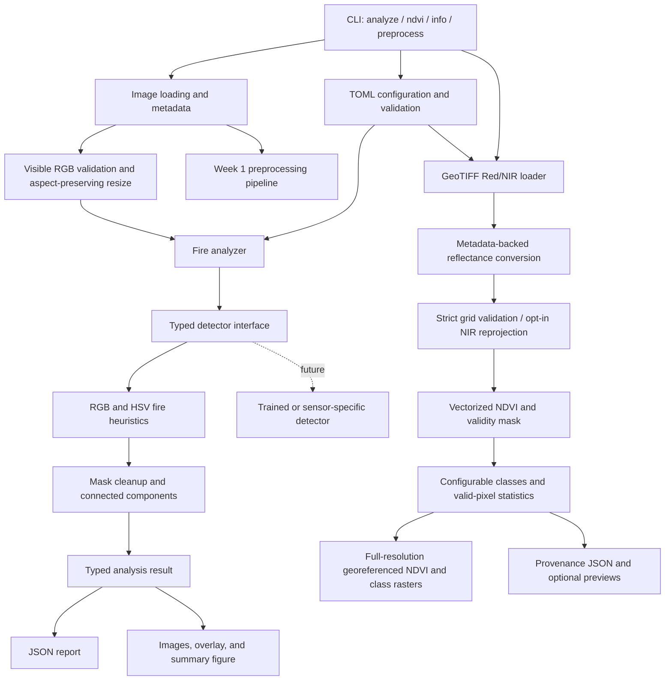

# Architecture

Satellite Image Analyzer separates input handling, preprocessing, detection,
reporting, and user interaction. Week 2 adds visible RGB fire analysis and Week 3
adds a separate real Red/NIR spectral analysis path, preserving Week 1 commands.



## Module boundaries

- `core` owns validated settings, TOML loading, and domain exceptions.
- `io` decodes images/raster bands and exposes metadata.
  `spectral_loader` validates real Red/NIR raster roles and spatial alignment;
  `radiometry` resolves conversion coefficients and records their provenance.
- `preprocessing` implements Week 1 resize, normalization, and denoise operations.
- `detectors` defines the detection interface and RGB fire implementation.
- `analyzer` validates visible images, prepares RGB, runs detection, maps measurements
  to the original grid, and assembles a typed result.
- `vegetation` computes NDVI, applies configured class boundaries, and summarizes
  valid spectral pixels through its own typed `NDVIAnalyzer` result.
- `visualization` creates bounding boxes, overlays, and a Matplotlib summary.
- `reporting` exports JSON using serializable types and finite numbers.
- `cli` presents results and handles expected failures with a nonzero exit status.

`ImageData` retains the decoded array without an extra copy and derives dimensions,
channels, and dtype from it. Rasterio preserves TIFF bands and available CRS and
transform metadata. The fire analysis path requires a known 8-bit visible image
interpretation; metadata alone does not make a raster suitable for RGB thresholds.

## Analysis data flow

```text
File validation -> Decode -> Visible RGB validation -> Optional resize
-> RGB/HSV thresholds -> Mask cleanup -> Connected components
-> Original-grid statistics and boxes -> Report and visualization
```

General normalization produces floating-point values for the Week 1 pipeline.
Fire thresholds operate on `uint8` RGB (0..255) and OpenCV HSV instead. OpenCV's
8-bit hue range is 0..179, not 0..360 degrees. Original pixels are preserved.
Images larger than the default maximum dimension of 2048 are reduced with
aspect ratio preserved. NumPy array operations and OpenCV components avoid
per-pixel Python loops.

Components smaller than `min_region_pixels` are discarded in the analysis grid.
The retained mask maps back to the original grid for exports and area statistics.
Boxes use original pixel coordinates with exclusive right/bottom extents,
avoiding off-by-one ambiguity when cropping.

Week 2 labels only `fire-like` and `unknown`; there are no competing vegetation,
water, or urban masks to resolve. Additional categories later require an explicit
conflict policy rather than assuming those detectors already exist.

## Confidence and results

A detection contains a binary mask, retained regions, and a heuristic confidence
score. It describes selected pixels' color evidence, not a trained probability
or calibrated estimate of an active fire. An empty detection returns zero
confidence. Results include input identity, original/analysis dimensions,
fire-like/unknown area, region measurements, timestamp, settings, and timing.
Measured analysis time covers loading, preparation, detection, and statistics;
it excludes artifact export. The report states this timing boundary.

Transparent and raster nodata pixels cannot supply detection evidence. They are
recorded as `invalid_pixel_count` and included in unknown. Area percentages use
all original pixels, including invalid pixels, so fire-like and unknown sum to 100.

Geographic coordinates, physical area, thermal evidence, NDVI, and risk are not
inferred from RGB pixels. Region positions refer to the image grid only.

## Export and errors

A timestamped, uniquely suffixed run directory is created below the selected
output root. Each run saves `analyzed_image.png`, `fire_mask.png`,
`fire_overlay.png`, `analysis_summary.png`, and `analysis_report.json`.
The source and earlier outputs are preserved. Matplotlib uses an off-screen
backend so export does not require an interactive desktop.

`--json` sends only report JSON to stdout. Diagnostics and expected errors use
stderr. Missing/corrupt files, unsuitable data, invalid settings, and unwritable
outputs produce explicit errors.

## Future detectors

Trained implementations should satisfy the same typed detector boundary and
return masks and region measurements in documented image coordinates. Export
and visualization can then consume their results without being rewritten.
Multispectral or thermal implementations also need explicit sensor/band metadata.

Week 4 anomaly/risk remains planned. Add model dependencies only alongside an
implementation, representative data, held-out evaluation, and an honest
accuracy/confidence contract.

## Week 3 spectral analysis

```text
GeoTIFF Red/NIR -> Source NoData/mask validation -> Radiometric calibration
-> Strict spatial alignment (or explicit NIR reprojection to Red)
-> Float32 NDVI and validity mask -> Vegetation classes/statistics
-> Full-grid scientific GeoTIFFs + provenance JSON + optional display previews
```

The spectral loader requires CRS and an affine grid, known band mapping, compatible
dimensions, and meaningful radiometric units. It never substitutes an RGB channel
for NIR. Integer DN must have metadata, explicit coefficients, or nonidentity TIFF
scale/offset; sensor names are not calibration rules. Sentinel product XML supplies
quantification and band-specific additive offsets. Landsat Collection 2 Level-2
MTL supplies surface-reflectance parameters. Already calibrated reflectance is
declared explicitly or, in `auto` mode, inferred only from finite float values in
[0,1], with that inference recorded. Source NoData is masked before correction.

Alignment is strict by default. Explicit `--align-nir` reprojects calibrated NIR
and its validity to the Red reference grid using the selected resampling method;
alignment decisions and original metadata remain in the report. Reflectance is
validated after calibration, and negative/nonfinite values or near-zero sums do
not enter NDVI statistics. The engine performs vectorized float32 arithmetic.

Vegetation maps use zero for invalid pixels and five configurable initial classes.
Statistics and percentages use valid NDVI pixels only, unlike Week 2 fire-area
percentages, which use all original image pixels. All-invalid scenes retain an
invalid mask and serialize undefined summaries as `null` rather than zero.

NDVI and class GeoTIFFs preserve full scientific resolution, CRS, transform, and
validity masks. Preview resizing is restricted to visualizations; histogram
statistics still use every valid pixel. Export adds a uniquely named run directory
and protects source bands and metadata files. NDVI remains a vegetation-condition
indicator; it adds neither a fire score nor an unsupported wildfire-risk factor.

See [Week 3 NDVI details](week3_ndvi.md) for calibration cases, input examples,
classification boundaries, data acquisition, and limitations.
