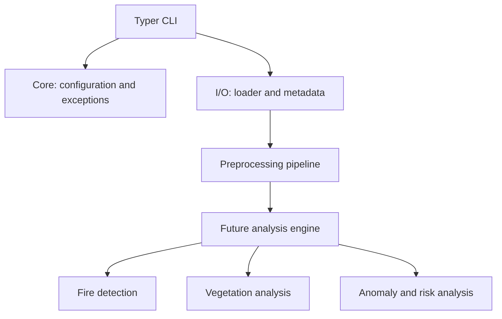

# Architecture

Satellite Image Analyzer keeps image acquisition, processing, and user interaction
separate so future analysis features can be added without rewriting the foundation.



## Modules

- `core` centralizes configuration models and user-facing domain errors.
- `io` validates image paths, decodes supported rasters, and extracts metadata.
- `preprocessing` provides independently testable resize, normalization, and noise
  reduction operations, composed by `PreprocessingPipeline`.
- `cli` remains a thin presentation layer: it calls application modules, renders
  human-readable output, and avoids stack traces for expected user errors.

`ImageData` is the boundary object between I/O and processing. It stores a NumPy
array without making an additional copy and derives dimensions, channels, and dtype
from that array. TIFF data is loaded via Rasterio to preserve raster band data and
allow metadata such as the CRS and transform to be surfaced when present.

The pipeline currently has one fixed, explicit sequence:

```text
Input -> Validation -> Resize -> Normalization -> Noise reduction -> Output
```

Additional analytical stages can consume `ImageData` or add pipeline components in a
future release while retaining the existing loader, metadata, and CLI contracts.
